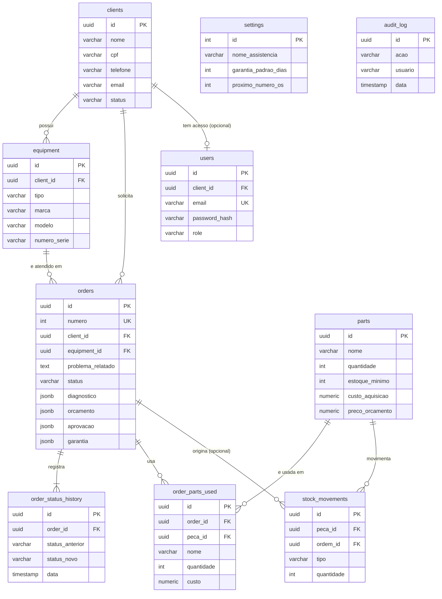

# DER e dicionário de dados

Banco **assistencia** (PostgreSQL). O modelo físico completo está em
[`01_schema.sql`](./01_schema.sql). Imagem do diagrama para slides: [`der.png`](./der.png).

## 1. Diagrama Entidade-Relacionamento

`settings` e `audit_log` não têm chave estrangeira: `settings` guarda uma linha única
de configuração e `audit_log` é um registro cronológico de ações.

## 2. Relacionamentos

| Relacionamento | Cardinalidade | Chave estrangeira | Ao excluir o "pai" |
| --- | --- | --- | --- |
| clients → equipment | 1:N | `equipment.client_id` | CASCADE (apaga os equipamentos) |
| clients → orders | 1:N | `orders.client_id` | bloqueia (histórico preservado) |
| equipment → orders | 1:N | `orders.equipment_id` | bloqueia |
| clients → users | 1:0..1 | `users.client_id` | bloqueia |
| orders → order_status_history | 1:N | `order_status_history.order_id` | CASCADE |
| orders ↔ parts | **N:N** | via `order_parts_used` (`order_id`, `peca_id`) | CASCADE na OS; bloqueia na peça |
| parts → stock_movements | 1:N | `stock_movements.peca_id` | bloqueia |
| orders → stock_movements | 1:N (opcional) | `stock_movements.ordem_id` | bloqueia |

`order_parts_used` é a **tabela associativa** do relacionamento N:N entre ordens e peças
(uma OS usa várias peças; uma peça é usada em várias OS) e carrega atributos próprios:
quantidade, custo e data.

## 3. Dicionário de dados

Legenda: **PK** chave primária · **FK** chave estrangeira · **UQ** único · **NN** não nulo.

### clients — clientes
| Coluna | Tipo | Restrições | Descrição |
| --- | --- | --- | --- |
| id | UUID | PK | Identificador |
| nome | VARCHAR(150) | NN | Nome completo |
| cpf | VARCHAR(11) | índice | Só dígitos, opcional |
| telefone | VARCHAR(11) | NN | Só dígitos |
| whatsapp, email, endereco, observacoes | VARCHAR/TEXT | | Contato e anotações |
| status | VARCHAR(20) | CHECK ativo/inativo | Situação do cadastro |
| created_at, updated_at | TIMESTAMP | | Datas (UTC) |

### users — acesso ao sistema
| Coluna | Tipo | Restrições | Descrição |
| --- | --- | --- | --- |
| id | UUID | PK | Identificador |
| name | VARCHAR(150) | NN | Nome |
| email | VARCHAR(254) | UQ, NN | Login |
| password_hash | VARCHAR(255) | NN | Hash bcrypt (nunca a senha) |
| role | VARCHAR(20) | NN, CHECK admin/client | Perfil de acesso |
| client_id | UUID | FK clients | Preenchido só para o perfil `client` |

### equipment — equipamentos
| Coluna | Tipo | Restrições | Descrição |
| --- | --- | --- | --- |
| id | UUID | PK | Identificador |
| client_id | UUID | FK clients, NN | Dono do equipamento |
| tipo | VARCHAR(20) | NN | `notebook` ou `computador` |
| marca | VARCHAR(50) | NN | Marca |
| modelo, numero_serie, acessorios, observacoes, senha | VARCHAR/TEXT | | Detalhes do aparelho |

### parts — peças em estoque
| Coluna | Tipo | Restrições | Descrição |
| --- | --- | --- | --- |
| id | UUID | PK | Identificador |
| nome | VARCHAR(150) | NN | Nome da peça |
| categoria, fabricante, modelo, codigo | VARCHAR | | Classificação |
| quantidade | INTEGER | CHECK >= 0 | Estoque atual |
| estoque_minimo | INTEGER | CHECK >= 0 | Abaixo disso, a peça aparece como "estoque baixo" |
| custo_aquisicao | NUMERIC(12,2) | CHECK >= 0 | Quanto a peça custou |
| preco_orcamento | NUMERIC(12,2) | CHECK >= 0 | Preço cobrado no orçamento |
| fornecedor, localizacao, status | VARCHAR | | Compra e armazenamento |

### orders — ordens de serviço
| Coluna | Tipo | Restrições | Descrição |
| --- | --- | --- | --- |
| id | UUID | PK | Identificador |
| numero | INTEGER | UQ, NN | Número sequencial da OS (vem de `settings.proximo_numero_os`) |
| client_id | UUID | FK clients, NN | Cliente |
| equipment_id | UUID | FK equipment, NN | Equipamento |
| problema_relatado | TEXT | NN | O que o cliente relatou |
| acessorios, estado_fisico, observacoes, prazo | VARCHAR/TEXT | | Dados da entrada (prazo em texto ISO) |
| status | VARCHAR(30) | NN, CHECK | ENTRADA, ORCAMENTO, AGUARDANDO_APROVACAO, EM_MANUTENCAO, PRONTO, ENTREGUE ou CANCELADO |
| diagnostico | JSONB | | `{diagnostico, testes, solucao}` |
| orcamento | JSONB | | `{itens[], maoObra[], desconto, totalPecas, totalMaoObra, total}` |
| aprovacao | JSONB | | `{status, data, usuario, observacao}` |
| garantia | JSONB | | `{periodoDias, dataInicio, dataFinal, condicoes, status}` (gerada na entrega) |
| data_conclusao, data_entrega | TIMESTAMP | | Preenchidas ao passar para PRONTO / ENTREGUE |

### order_status_history — histórico de status
| Coluna | Tipo | Restrições | Descrição |
| --- | --- | --- | --- |
| id | UUID | PK | Identificador |
| order_id | UUID | FK orders, NN | OS |
| status_anterior | VARCHAR(30) | | Nulo na criação da OS |
| status_novo | VARCHAR(30) | NN | Novo status |
| data, usuario | TIMESTAMP, VARCHAR | | Quando e quem mudou |

### order_parts_used — peças usadas na OS (N:N)
| Coluna | Tipo | Restrições | Descrição |
| --- | --- | --- | --- |
| id | UUID | PK | Identificador |
| order_id | UUID | FK orders, NN | OS |
| peca_id | UUID | FK parts, NN | Peça |
| nome | VARCHAR(150) | NN | Nome da peça **no momento do uso** |
| quantidade | INTEGER | NN, CHECK > 0 | Unidades usadas |
| custo | NUMERIC(12,2) | | Custo unitário **no momento do uso** |
| data, usuario | TIMESTAMP, VARCHAR | | Quando e quem registrou |

### stock_movements — movimentações de estoque
| Coluna | Tipo | Restrições | Descrição |
| --- | --- | --- | --- |
| id | UUID | PK | Identificador |
| peca_id | UUID | FK parts, NN | Peça movimentada |
| tipo | VARCHAR(20) | NN, CHECK entrada/saida | Sentido da movimentação |
| quantidade | INTEGER | NN, CHECK > 0 | Unidades |
| ordem_id | UUID | FK orders | Preenchido quando a saída é uso em OS |
| data, usuario, motivo | | | Quando, quem e por quê |

### settings — configurações (uma linha)
`id` (sempre 1, CHECK), `nome_assistencia`, `telefone`, `whatsapp`, `email`, `endereco`,
`categorias`/`marcas`/`servicos` (JSONB, listas usadas nos formulários),
`garantia_padrao_dias` (padrão 90) e `proximo_numero_os` (contador das OS).

### audit_log — auditoria
`id`, `acao`, `detalhe`, `usuario`, `data`: registra quem fez o quê no sistema.

## 4. Decisões de modelagem

- **Normalização (1FN/2FN/3FN).** Cada tabela tem chave primária, cada coluna guarda um
  valor e os dados de cliente, equipamento e peça ficam nas suas próprias tabelas, ligados
  por chave estrangeira em vez de repetidos em cada OS.
- **Desnormalização proposital em `order_parts_used`.** O nome e o custo da peça são
  copiados para a linha de uso. Assim, se o preço ou o nome da peça mudar depois, o
  histórico da OS continua correto (a mesma recomendação da aula de consultas avançadas:
  "gravar o preço praticado").
- **JSONB em `orders`.** Diagnóstico, orçamento, aprovação e garantia pertencem a uma única
  OS e são sempre lidos juntos com ela, então viraram colunas JSONB. Em troca, o banco não
  valida a estrutura interna, e as consultas usam os operadores `->` e `->>`
  (veja `03_consultas.sql`, partes 3.6 e 4.2). Histórico de status e peças usadas, que são
  listas que crescem, ganharam tabelas próprias.
- **Chaves UUID.** Os identificadores não são sequenciais, o que evita adivinhar ids em
  URLs da API. O número amigável da OS fica separado, em `orders.numero`.
- **Regras de integridade no banco.** Além de PK, FK e UNIQUE, há CHECKs: estoque nunca
  negativo, quantidades de movimentação positivas, status e perfis só com valores válidos.
  Assim, mesmo um acesso direto ao banco não consegue gravar dados inválidos.

## 5. Pontos de atenção (para evoluir o sistema)

- `equipment.senha` guarda a senha do aparelho do cliente em texto puro; vale avaliar
  criptografar ou remover.
- `orders.prazo` é texto (`yyyy-mm-dd`); o tipo `DATE` seria mais adequado.
- `updated_at` é atualizado pela aplicação (SQLAlchemy). Quem alterar o banco direto
  precisa atualizar a coluna manualmente, ou o banco pode ganhar um *trigger*.
- No backend, a baixa de estoque lê a quantidade e depois grava, sem travar a linha. Dois
  atendimentos simultâneos na última unidade poderiam ambos passar na verificação. A função
  `usar_peca_em_os` de `04_transacoes.sql` mostra a versão com `SELECT ... FOR UPDATE`.
